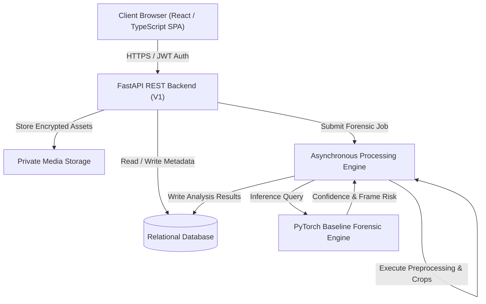

# MINO System Architecture

## Service Boundaries
1. **Frontend (`apps/web`)**: Single-page application rendering real-time job status, video risk timelines, and forensic reports.
2. **API (`apps/api`)**: High-performance asynchronous REST API handling auth, upload guards, and queries.
3. **Forensics Engine (`ml/src/mino_ml`)**: Neural network backbones, face detection cascades, and temporal risk aggregators.
