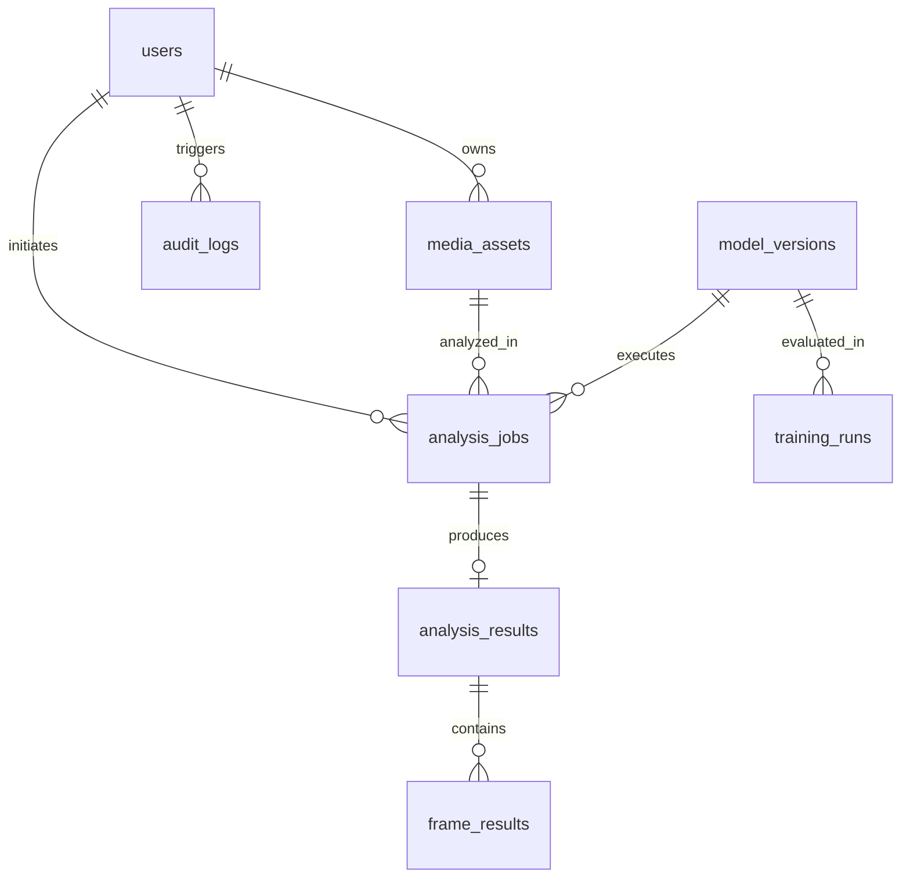

# MINO Database Schema & Migrations

MINO uses SQLAlchemy 2.0 with Alembic migrations.

## Entity-Relationship Overview

## Migration Commands
- Create migration: `alembic revision --autogenerate -m "migration_description"`
- Apply migration: `alembic upgrade head`
- Rollback migration: `alembic downgrade -1`
- Seed initial data: `python scripts/seed_db.py`
